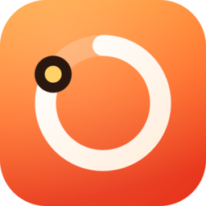
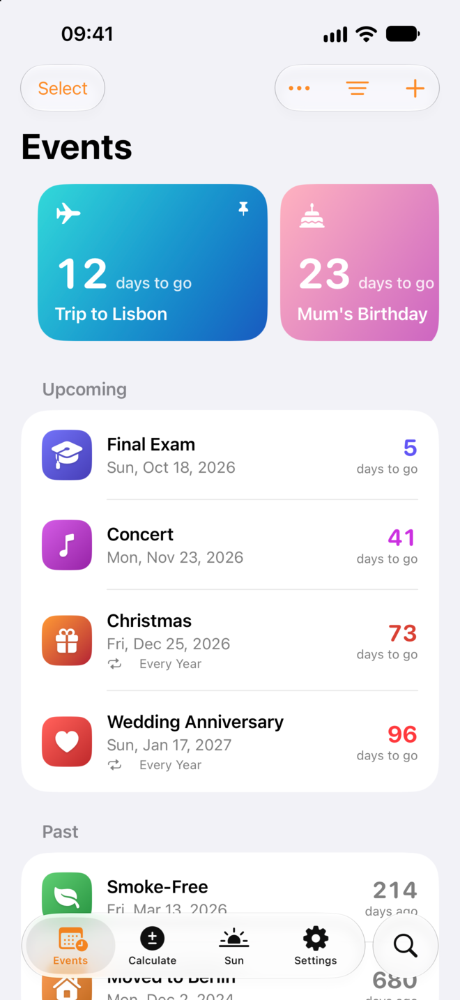
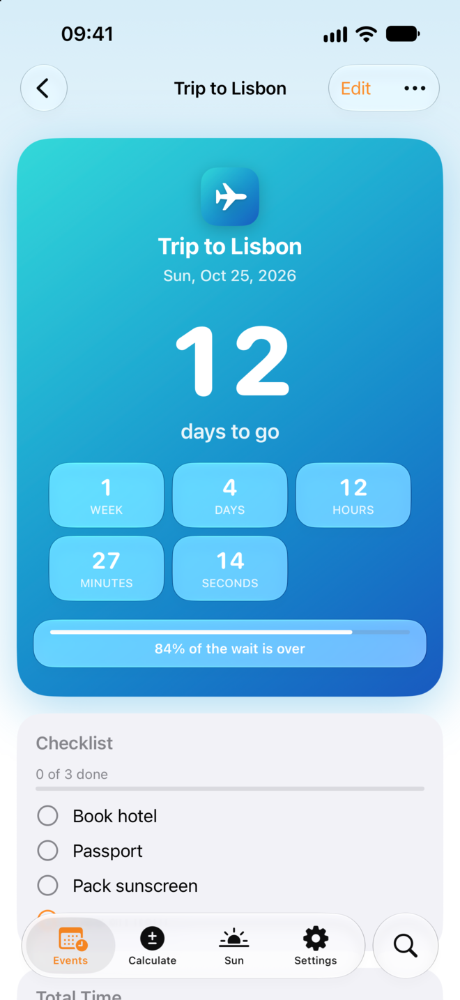
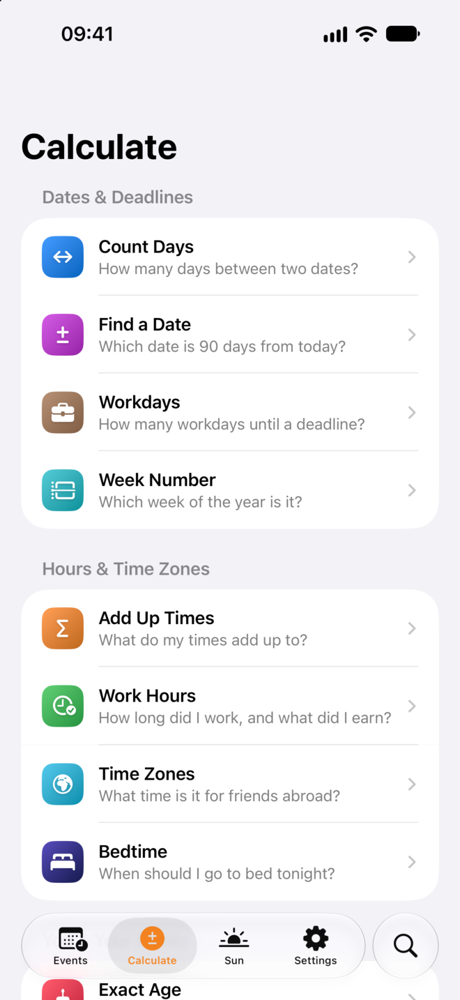
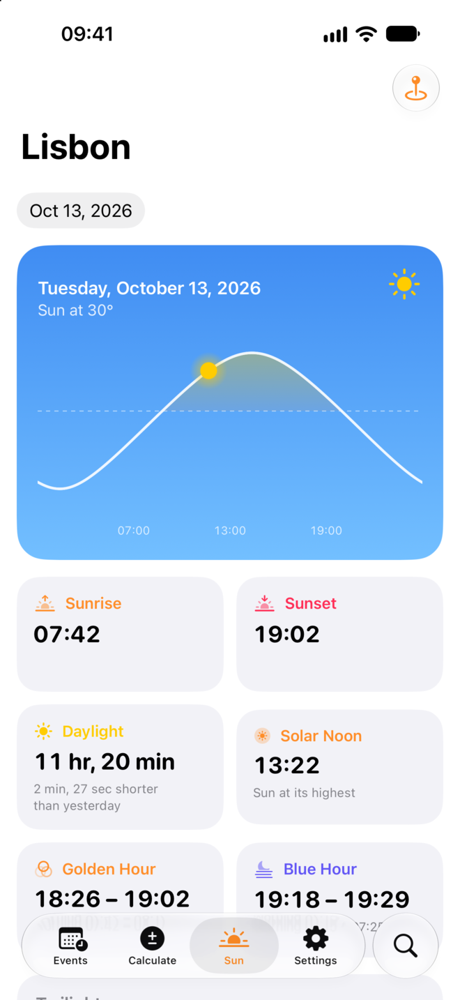

<p align="center">
  
</p>

<h1 align="center">Timity</h1>

<p align="center">
  Count down to the moments ahead and see how long since the ones behind you — on iPhone, iPad and Apple Watch.
</p>

<p align="center">
  <a href="https://apps.apple.com/app/id491746507"></a>
  
  
  
  
  
  
  
  <a href="https://github.com/LinkAndreas/Timity/actions/workflows/deploy.yml"></a>
</p>

Timity keeps the dates that matter in sight — birthdays, trips, exams, anniversaries — and counts
the days to each, or since it happened. Alongside, it answers everyday questions about time: how
many days between two dates, which date is 90 days from today, how many workdays until a
deadline, and when the sun sets wherever you are.

## Screenshots

<table>
  <tr>
    <td align="center" valign="top"><picture><source media="(prefers-color-scheme: dark)" srcset="Docs/Images/Screenshots/iphone-events-dark.png"></picture><br><sub>Events, pinned ones first</sub></td>
    <td align="center" valign="top"><picture><source media="(prefers-color-scheme: dark)" srcset="Docs/Images/Screenshots/iphone-event-dark.png"></picture><br><sub>A live countdown with progress</sub></td>
    <td align="center" valign="top"><picture><source media="(prefers-color-scheme: dark)" srcset="Docs/Images/Screenshots/iphone-calculate-dark.png"></picture><br><sub>Calculators by question</sub></td>
    <td align="center" valign="top"><picture><source media="(prefers-color-scheme: dark)" srcset="Docs/Images/Screenshots/iphone-sun-dark.png"></picture><br><sub>Sunrise, sunset and golden hour</sub></td>
  </tr>
</table>

## Features

- **Countdowns and count-ups** — to a date or since one, by the day or live to the second, with
  repeats from daily to yearly (including lunar and other calendars), progress bars, checklists,
  photos, notes, reminders and lists
- **Quick to fill** — templates for common events, or type "Mum's birthday on 3 March" and Timity
  fills in the rest; import birthdays and anniversaries from Contacts, events from Calendar, and
  public holidays for many countries
- **Calculators** that each answer one question — Count Days, Find a Date, Workdays, Week Number,
  Add Up Times, Work Hours, Time Zones, Bedtime, Exact Age, Life in Weeks and Due Date
- **Sun** — sunrise, sunset, golden and blue hour and twilight for your location or any city you
  choose, each in its own time zone
- **iCloud sync** across iPhone, iPad and Apple Watch, with the sync status in sight and guided
  help when something's off
- **Everywhere on the system** — widgets, Lock Screen and Apple Watch complications, Live
  Activities, a Control Center control, Siri and Shortcuts, and Spotlight
- **Apple Watch app** — your events on the wrist; add and delete them there too
- **iPad** — one sidebar for everything, with events in three columns
- **Support the Developer** — optional tips and subscriptions that unlock alternative app icons;
  every feature stays free
- **Localized** in English, German, Spanish and French

## Privacy

Timity has no account and no server. Events live on your devices and, if you turn sync on, in your
private iCloud database, which only you can read. Read the
[privacy policy](https://www.linkandreas.de/timity/privacy/en/).

## Requirements

- Xcode 27 or later
- iOS / iPadOS 26 and watchOS 26
- An Apple Developer account with the iCloud container and app group set up as in
  [Docs/Setup.md](Docs/Setup.md), to build for a device

The project has no third-party dependencies.

## Getting started

```bash
git clone https://github.com/LinkAndreas/Timity.git
open Timity/Timity.xcodeproj
```

Choose the **Timity** scheme and run it on an iPhone or iPad simulator. Simulators signed in to
iCloud sync too.

Debug builds take two launch arguments:

- `-ScreenshotSamples` replaces the events with a set of sample events, for screenshots.
- `-PrepareCloudKitSchema` creates the CloudKit schema in the development environment, ready to
  deploy to production in the CloudKit Console. Do this whenever a synced field is added; a test
  fails as a reminder until the field is listed as deployed.

## Tests

```bash
xcodebuild test -project Timity.xcodeproj -scheme Timity -destination 'platform=iOS Simulator,name=iPhone 17'
```

About a hundred Swift Testing tests cover date math, repeats in every calendar, sun times,
milestones, holidays, the calculators, reminders, the event store and iCloud sync repair.

## Deploying

Every merge into `master` — a finished git-flow release or hotfix — runs
[`deploy.yml`](.github/workflows/deploy.yml) on a self-hosted Mac: it runs the tests, archives and
signs the app, the Watch app and both widget extensions, and uploads the build to App Store
Connect. The secrets it needs are listed in [Docs/Setup.md](Docs/Setup.md).

## Project structure

| Folder           | What                                                                    |
|------------------|-------------------------------------------------------------------------|
| `App/`           | The iPhone and iPad app: screens, the composition root and services     |
| `Shared/`        | Date and sun math, the event model and store, App Intents, strings      |
| `Widgets/`       | The widget extension's entry point, Live Activity and Control           |
| `WidgetsShared/` | Widgets and complications for iPhone and Apple Watch                    |
| `Watch/`         | The Apple Watch app                                                     |
| `WatchWidgets/`  | The Apple Watch complications' entry point                              |
| `Tests/`         | Swift Testing tests                                                     |
| `Config/`        | Entitlements, Info.plist additions and the StoreKit configuration       |

Views get what they need through their initializers — values, bindings and closures — and
frameworks such as SwiftData, CloudKit, WidgetKit and CoreLocation sit behind small protocols, wired
up in one place per target (`AppComposition`, `WatchComposition`, `WidgetComposition`).
